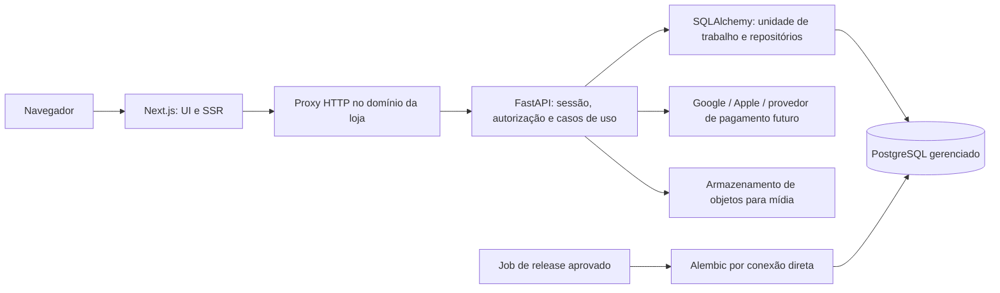

# FocusStore — plano de migração para FastAPI, SQLAlchemy e PostgreSQL

**Data:** 03/11/2026. **Estado:** proposta para aprovação, sem implementação.
**Escopo desta entrega:** auditoria de código, consultas locais somente leitura,
pesquisa em documentação oficial e criação deste documento. Nenhuma migration,
seed, deploy ou alteração de código/.env/banco foi executada nesta etapa.

## 1. Decisões propostas para aprovação

| Tema | Proposta | Condição antes de executar |
| --- | --- | --- |
| Dono dos dados | FastAPI concentra autorização, regras e persistência; SQLAlchemy mapeia o domínio completo; Alembic é o único responsável pelo schema final | Aprovação deste desenho e dos contratos com a equipe frontend |
| PostgreSQL | **Supabase PostgreSQL é o provedor escolhido**; Neon permanece apenas como comparação histórica | Validar região, orçamento, recuperação, rede e plano do Supabase; não foi criado projeto nem contratado serviço |
| Frontend | Next.js mantém UI, SSR e cache de conteúdo público; um proxy/BFF fino no mesmo domínio encaminha HTTP para FastAPI | Proxy não consulta banco, calcula preço, autoriza papéis ou autentica por conta própria |
| Identidade | Um único sistema de usuários/contas/sessões, transferido ao FastAPI; preservar IDs, hashes e vínculos existentes | Ensaio de compatibilidade de senhas, cookies, OAuth e revogação |
| Dados canônicos | Modelar o catálogo rico Prisma em SQLAlchemy; preservar IDs string inicialmente; schema PostgreSQL `store` proposto | Não tentar reduzir os dados às duas tabelas simples atuais |
| Catálogo Python antigo | Preservar tabelas/IDs inteiros e rotas `/products`, `/categories` como legado durante transição | Inventariar consumidores e dados antes de adaptar ou retirar |
| Corte | Ensaio em homologação, congelamento coordenado de escritas e troca única do domínio de escrita | Não permitir Prisma/SQLite e FastAPI/PostgreSQL escrevendo simultaneamente o mesmo domínio |
| Hospedagem | Next.js pode permanecer na Vercel; FastAPI em serviço Python/container persistente como referência inicial; Vercel Python é opção viável condicionada a PoC | Medir latência, conexões, dependências e limites com ambiente isolado |

A decisão atual da equipe é **Supabase PostgreSQL**. A recomendação anterior de
Neon foi substituída nesta revisão. A hospedagem persistente continua uma
proposta técnica a validar, sem aprovação para provisionamento. Supabase Auth
não faz parte desta migração: a autenticação existente será centralizada no
FastAPI, preservando a identidade dos usuários.

## 2. Diagnóstico da arquitetura atual

### 2.1 Persistência e APIs

O checkout local está na branch `main`, HEAD `6003759`, com alterações locais das
etapas anteriores. Elas foram preservadas. A auditoria usa o conteúdo atual da
árvore de trabalho, inclusive a base backend ainda não commitada.

- `prisma/schema.prisma` declara **SQLite**, com 30 models. O cliente é
  centralizado em `src/lib/db/prisma.ts`, que usa a variável `DATABASE_URL`.
- `prisma/migrations/migration_lock.toml` e a migration inicial versionada
  declaram **PostgreSQL**. O histórico de preparação não corresponde ao provider
  efetivo do schema. Não é seguro aplicar essa migration como se a migração
  estivesse concluída.
- Next.js executa consultas e regras de negócio em Server Components, route
  handlers e serviços. Retirar apenas `@prisma/client` quebra todos esses usos.
- SQLAlchemy tem somente `Category` e `Product` persistentes: IDs inteiros,
  produto com `Numeric(10,2)`, stock e uma categoria. Alembic tem head
  `e0dd9a760a45` e histórico anterior que deve ser preservado.
- A base FastAPI ampliada usa o SQLite Prisma em modo somente leitura para
  catálogo, cotação, sessão e pedidos próprios. Isso também precisa ser
  substituído: retirar Prisma do npm não elimina a dependência Python do SQLite.
- O contrato versionado em `backend/docs/openapi.json` tem **20 operações em 14
  caminhos**. Há CRUD simples, ajuste de stock, catálogo rico de leitura,
  `/api/v1/cart/quote`, `/api/v1/users/me` e pedidos próprios de leitura.
- Não há criação de pedido/reserva de compra nem autenticação emissora completa
  no FastAPI atual. A cotação não reserva estoque; o carrinho da UI usa
  localStorage. Existem tabelas Cart/CartItem no Prisma, o que não comprova que
  o fluxo de UI as utiliza.
- Último resultado registrado: **112 testes aprovados, 5 pulados**. Não foram
  reexecutados nesta tarefa de planejamento. Esse resultado não certifica
  PostgreSQL real, OAuth real, hospedagem ou integração ponta a ponta.

Referências locais: [relatório anterior](../IMPLEMENTATION_REPORT.md),
[contrato de integração atual](API_INTEGRATION.md) e
[OpenAPI atual](openapi.json).

### 2.2 Sobreposição entre modelos

| Conceito | Prisma/SQLite | SQLAlchemy atual | Tratamento proposto |
| --- | --- | --- | --- |
| Product | ID string, slug/SKU, imagens, variantes, preços, status, SEO e dimensões | ID inteiro, nome, descrição, price, stock, category_id | Modelo canônico rico em `store`; não copiar sobre a tabela simples |
| Category | ID string, hierarquia, metadados, posição, ativo; N:N com produto | ID inteiro, nome e slug; 1:N | Preservar hierarquia e tabela associativa no canônico |
| Estoque | Inventory e movimentos por variante, disponível/reservado | Campo stock no produto | Domínios diferentes; não somar nem substituir automaticamente |
| Usuário/sessão | User, Account, Session, VerificationToken | Sem tabelas ORM; ponte de leitura | Transferir o mesmo domínio e identidades, sem segundo cadastro |
| Pedidos e carrinho | Tabelas ricas, snapshots, pagamentos/entregas/histórico | DTOs e leitores, sem persistência equivalente | Modelar relações completas antes de transferir a escrita |

Não há correspondência confiável entre um produto inteiro do backend e um
produto string da loja apenas pelo nome. Se houver dados reais no banco Python,
eles exigem inventário e mapeamento explícitos; não foram acessados bancos da
empresa nem remotos nesta auditoria.

### 2.3 Dados locais observados e preservação

Consultas foram feitas com SQLite `mode=ro` e `query_only`, sem imprimir dados
pessoais, tokens, hashes ou credenciais. Números são inventário local, **não
inventário de produção**.

| Tabela / verificação | `prisma/dev.db` | `prisma/dev.backup.db` |
| --- | ---: | ---: |
| users | 2 | 4 |
| accounts | 0 | 0 |
| sessions | 0 | 0 |
| categories | 7 | 7 |
| products | 10 | 19 |
| product_variants | 52 | 56 |
| inventory | 52 | 56 |
| orders | 0 | 2 |
| order_items | 0 | 0 |
| payments | 0 | 0 |
| PRAGMA integrity_check | ok | ok |
| Violações de foreign keys | 0 | 0 |

O backup tem pedidos sem itens e diverge da base atual. Integridade estrutural
não prova completude de negócio. Não há evidência para concluir que são dados
reais ou fictícios, que o backup é mais correto, ou que não existem pedidos em
outro ambiente. **Não sobrescrever um arquivo com o outro, juntar por soma nem
recriar itens/preços fictícios.** Preservar ambos e tratar divergências como
bloqueio da seleção da fonte autoritativa.

Antes da execução, o responsável deve identificar a fonte usada pelo ambiente
real, eventuais exports autorizados, arquivos de mídia e WAL/SHM associados.
Todos os 30 conjuntos de tabelas devem ser considerados, inclusive tabelas
vazias. Sessões/contas vazias nestes arquivos não autorizam descartar a
compatibilidade com sessões de outro ambiente.

## 3. Dependências do Prisma e acesso direto do Next.js

A busca estática encontrou **36 arquivos em `src/`** com importação do Prisma,
importação do cliente central ou uso direto de `prisma.*`; **6 scripts**, **3
suítes TypeScript** e `prisma/seed.ts`. O apêndice lista esses arquivos.
Também há dependências indiretas: páginas que chamam CatalogService,
CheckoutService, OrderService e outros serviços sem importar Prisma diretamente.
A retirada exige percorrer esses consumidores, não apenas fazer busca por import.

| Área | Arquivos/grupos | Substituição planejada |
| --- | --- | --- |
| Cliente/URL | `src/lib/db/prisma.ts`, `src/lib/db/database-url.ts` | Cliente HTTP tipado; remover DATABASE_URL do Next após o corte |
| Sessão/permissões | `src/lib/auth/session.ts`, `admin.ts`, social/* | Consulta ao FastAPI; checagens na UI apenas orientam navegação, API é a autoridade |
| Serviços | módulos admin, catalog, checkout, inventory, orders, payments, promotions | Mover regras e consultas para serviços FastAPI; manter adapters temporários de contrato |
| Server Components | conta/pedidos e endereços; admin/auditoria, pedidos e páginas de produtos | HTTP servidor→FastAPI, encaminhando sessão com segurança e sem cache privado |
| Route handlers | `/api/admin/*`, `/api/auth/*` com Prisma | Proxy fino/adapter temporário; sem ORM nem regra de negócio após delegação |
| Scripts | seeds, imagens e verificação de compra | Substituir por comandos Python aprovados, ou retirar do fluxo; preservar dados históricos |
| Build/pacotes | `package.json`, lockfile, overrides/allowScripts Prisma | Retirar dependências e `prisma generate` somente no encerramento |
| Next config | `serverExternalPackages`, `outputFileTracingIncludes` de prisma | Limpar após eliminar todos os consumidores |
| CI/testes | `.github/workflows/frontend-quality.yml`, testes sociais/store/fullstack | Testar contratos HTTP; fixtures PG pertencem ao backend; remover geração/migrations Prisma |
| Python | `prisma_sqlite.py`, adaptador legacy_catalog, segurança e serviços cart/orders | Trocar adaptadores por repositórios SQLAlchemy; depois retirar o leitor SQLite |
| Histórico | schema e migration PostgreSQL Prisma, documentação antiga | Preservar como evidência/arquivo; Alembic será o executor exclusivo futuro |

`prisma/seed.ts` contém exclusões em massa. Outros scripts de variantes/produtos
removem registros relacionados, inclusive itens de pedidos. **Eles não são uma
ferramenta de importação nem devem entrar no pipeline de migração.** Nenhum deles
foi executado. A retirada futura de Prisma não implica apagar bancos, backups
ou histórico Git. Bancos locais já rastreados exigem tratamento separado para
não voltarem a ser publicados em commits.

## 4. Arquitetura proposta

Proposta de módulos, evoluindo a estrutura existente: `api/routes`, `schemas`,
`services`, `security`, `models`, `repositories`, `db` e `integrations`.
Não são necessários microserviços ou troca automática para ORM assíncrono.
SQLAlchemy + Psycopg síncronos existentes são um ponto de partida adequado;
escolher async só se medições justificarem e houver orçamento de adaptação.

### 4.1 Schema canônico e legado

- Propor `store` para tabelas canônicas ricas e explicitar o schema nos mappings,
  foreign keys e Alembic; não depender de `SET search_path` persistente em pooler.
- Preservar o histórico Alembic atual; criar revisões novas após aprovação.
  No banco novo, testar a linhagem completa e a criação do schema canônico.
  Não usar `stamp` ou editar migrations antigas para esconder divergência.
- As tabelas simples antigas em `public` continuam claramente identificadas como
  legado; não criar `store.products` apontando ao model inteiro anterior.
  As rotas legadas ficam compatíveis até inventariar clientes e aprovar retirada.
- Preservar inicialmente os IDs string existentes como TEXT, incluindo FKs.
  Não exigir conversão imediata para UUID nativo sem auditar todos os valores,
  scripts e referências externas. Os novos IDs podem continuar sendo UUIDs
  serializados como string, sem reatribuir IDs históricos.
- Para dados legados inteiros confirmados, criar mapa de importação por
  `(source_system, source_table, source_id) → canonical_id`, com unicidade e
  trilha de decisão. Nunca converter o inteiro 1 em um ID de produto Prisma
  arbitrário, nem mesclar por nome/e-mail sem revisão.

### 4.2 Cobertura de dados do modelo final

| Domínio | Tabelas Prisma a representar em SQLAlchemy/Alembic |
| --- | --- |
| Identidade | users, accounts, sessions, verification_tokens |
| Clientes | addresses |
| Catálogo | categories, collections, products, product_images, product_variants, product_categories, collection_products |
| Inventário | inventory, inventory_movements |
| Compra | carts, cart_items, orders, order_items, order_status_history |
| Pagamento/entrega | payments, webhook_events, shipments |
| Marketing/experiência | coupons, coupon_usages, banners, reviews, wishlists, wishlist_items |
| Operação | audit_logs, settings |

O mapeamento de cada coluna deve especificar origem, destino, tipo, nullability,
normalização, default, índice, chave única, FK e política de exclusão. Isso será
um artefato revisado antes da primeira migration de execução.

Compatibilidades que exigem decisão explícita:

- **Dinheiro:** Float/REAL→Numeric, proposta inicial Numeric(14,2) para valores
  monetários, validando range real; Decimal e arredondamento documentado.
  Percentuais/pesos/dimensões têm semântica própria. Não arredondar silenciosamente
  totais históricos que não conciliam; registrar conflitos por centavos.
- **Datas:** milissegundos/ISO SQLite→TIMESTAMPTZ UTC, mantendo instantes e
  expirações. Nunca interpretar timestamp legado como fuso local do notebook.
- **Booleanos/nulls:** converter 0/1 explicitamente e rejeitar valores inválidos;
  preservar distinção entre null, zero, string vazia e campo ausente.
- **Unicidade:** auditar e-mail sem distinção de caixa, CPF formatado/dígitos,
  SKU, slug e identificador do provedor. Colisões bloqueiam a carga daquele lote,
  sem deletar ou criar sufixos inventados.
- **Relacionamentos:** manter N:N, hierarquia e FKs; ordem de importação deve
  respeitar pais. Preservar snapshots de nomes/SKU/preços do pedido mesmo se o
  produto foi alterado ou arquivado.
- **Inventário:** disponível já exclui reservado. Não subtrair duas vezes.
  Conciliar movimentos, saldo e reservas por pedido, sem fabricar movimentos.
- **Enums e exclusão:** mapear todos os valores realmente encontrados; não
  transformar estados desconhecidos em PENDING. Preferir arquivamento de
  catálogo vinculado a compras; revisar cascatas que poderiam apagar histórico.
- **JSON e payloads:** preservar representação bruta necessária a auditoria ou
  assinatura de webhook. Converter a JSONB apenas campos cuja semântica foi
  validada; não perder bytes relevantes a verificações criptográficas.

## 5. Supabase PostgreSQL escolhido e comparação histórica

**Supabase PostgreSQL é o destino definido.** A comparação com Neon abaixo é
mantida apenas como registro da análise, não como escolha ainda pendente. O
Supabase será usado para persistência PostgreSQL; nenhuma Data API direta do
navegador ou Supabase Auth passa a concorrer com as responsabilidades do FastAPI.
Usar schema `store` fora dos schemas expostos pela Data API, com grants mínimos;
confirmar essa configuração no projeto antes de carregar dados privados.

| Critério | Neon | Supabase | Implicação para FocusStore |
| --- | --- | --- | --- |
| Conexões | Endpoint pooled com PgBouncer; pool não equivale à capacidade de transações simultâneas [N1] | Direct, pooler de sessão e de transação, com diferenças de rede [S1] | Escolher endpoint conforme runtime; limitar conexões da aplicação |
| Ambientes | Branches, inclusive somente schema [N2] | Branching disponível, com opções de população [S2] | Não clonar dados pessoais em previews por padrão |
| Escopo da adoção | Usar PostgreSQL sem acoplar outros serviços | Usar PostgreSQL sem adotar Auth/Data API automaticamente | Preserva a decisão de regras e autenticação no FastAPI |
| Recuperação | Janela de histórico depende da configuração/plano [N3] | Backups/PITR dependem do plano e configuração [S3] | Contratar e ensaiar restauração, não presumir cobertura do plano grátis |
| Custos | Avaliar compute, armazenamento, rede e ambientes na cotação oficial [N4] | Avaliar projeto/compute, armazenamento, rede e adicionais [S4] | Comparar custo total com mesma carga e política de backup |
| Rede/driver | Validar Psycopg e TLS no endpoint escolhido | Direct pode exigir IPv6 ou adicional IPv4; pooler tem alternativas [S1] | Testar a partir do host real, não apenas do notebook |

**Decisão aprovada de provedor:** realizar o ensaio e a futura migração no
Supabase PostgreSQL. Permanecem pendentes a seleção de região/plano, a política
de backup/PITR, o orçamento e a validação de conexão a partir da hospedagem real.
Neon não deve ser provisionado como parte desta entrega. Confirmar preços e
limites Supabase na contratação, sem inserir valores fixos no código.

### 5.1 Separação dos ambientes

| Ambiente | Banco/dados | Acesso e credenciais |
| --- | --- | --- |
| Local | PostgreSQL de desenvolvimento ou projeto nonprod remoto autorizado; SQLite preservado só como fonte de ensaio | Usuário individual, nunca senha de produção |
| CI | PostgreSQL descartável por job, mesma versão principal escolhida para destino | Credenciais temporárias; sem acesso a produção |
| Preview/PR | Branch/database isolado, schema + dados sintéticos | Origem/callback próprios; expiração e limpeza de recursos aprovada |
| Homologação | Projeto nonprod separado, rehearsal de importação autorizado e dados mascarados | Roles próprias, revisão de acesso, sem efeitos em provedores reais |
| Produção | Projeto/credenciais separados de nonprod, região aprovada e recuperação habilitada | Runtime sem DDL, migrator separado, backups e importador com privilégio limitado no tempo |

Branches do provedor não substituem controle de acesso. Produção não deve ser o
pai padrão de previews que copiam dados. Projetos distintos são a preferência
para separar os domínios de credenciais e reduzir erros de destino. Escolher a
versão PostgreSQL após validar disponibilidade do provedor e CI; não presumir
que a versão usada no workflow atual é a mesma do serviço contratado.

### 5.2 Conexões, TLS e credenciais

Proposta para implementação posterior:

- Psycopg 3 com SQLAlchemy, URL de aplicação no formato
  `postgresql+psycopg://<role>:<secret>@<host>/<db>`; parâmetros concretos virão do
  provedor. Não copiar parâmetros Prisma como `pgbouncer=true` para Psycopg.
- Separar `DATABASE_URL` (runtime) de `MIGRATION_DATABASE_URL` (DDL por endpoint
  direto). O env.py Alembic atual lê DATABASE_URL: precisará de adaptação
  explícita e teste para usar a variável de migration, sem fallback silencioso
  para o banco errado. As variáveis propostas ainda não existem no código.
- Serviço persistente: pool SQLAlchemy pequeno, `max_overflow` limitado,
  pre-ping, timeouts de conexão/statement/lock e sessão por requisição; fechar
  sessão no finally e rollback em erro. Pool total é multiplicado por workers
  e réplicas, não compartilhado magicamente entre elas.
- Serverless: preferir endpoint pooled e `NullPool` inicialmente, deixando o
  provedor administrar conexões; validar aquisição e custo sob concorrência.
  A orientação SQLAlchemy/Supabase recomenda esse arranjo para autoscaling [S5].
- Preparação de statements depende do endpoint. No shared transaction pooler
  Supabase, começar com `prepare_threshold=None` no connect_args Psycopg; não
  usar 0 como se desabilitasse preparação. Neon tem suporte a prepared statements
  de protocolo, mas a combinação real deve ser ensaiada [S1], [P1], [N1].
- Não manter transação aberta durante chamadas OAuth, pagamento ou upload.
  Não depender de estado de sessão do servidor em pool de transações.
- Exigir TLS; preferir `sslmode=verify-full` com CA/hostname conforme o provedor.
  `require` criptografa, mas não equivale a verificar a identidade do servidor;
  Supabase documenta a configuração de certificado [S6]. Nunca desabilitar
  verificação para passar um teste de conectividade.
- Runtime só faz DML no schema necessário; migrator faz DDL; importador tem
  permissão temporária; leitor/auditor usa role somente leitura. Não expor
  owner/service-role do provedor ao browser.
- Segredos no gerenciador da hospedagem/CI e arquivo local ignorado. Não usar
  NEXT_PUBLIC_ para URLs com senha, chaves OAuth ou segredo de sessão. Redigir
  logs/tracebacks e separar credenciais por ambiente.

Critério de capacidade proposto: definir carga esperada `C`, número máximo de
réplicas/workers e orçamento de conexões `B` do endpoint; configurar
`réplicas × workers × (pool_size + max_overflow) + jobs + reserva <= B` para
conexões diretas. Em pooler, medir separadamente limites de clientes e de
transações ativas, filas e latência. Não adotar números arbitrários como
capacidade contratada.

## 6. Estratégia de migração de dados sem perdas

As etapas abaixo são planejamento e **não autorização para executar migrations
ou importações**. Exigem aprovação operacional do destino, backup e janela.

1. **Inventário e fonte:** listar todas as bases/arquivos/ambientes e seus donos;
   confirmar qual é autoritativo por domínio. Resolver as diferenças entre os
   dois SQLite locais e a ausência de itens dos pedidos no backup. Dados
   ausentes entram em relatório; não são preenchidos com seed.
2. **Snapshot consistente:** coordenar parada de escritas ou snapshot de backup
   consistente com a base em uso, tratando WAL/SHM corretamente. Não copiar
   apenas o .db aberto e presumir consistência. Registrar checksum, horário,
   versão de schema, origem e cadeia de custódia em armazenamento restrito.
3. **Destino e mappings:** aprovar mapa coluna a coluna, política de conflitos,
   roles, constraints e linhagem Alembic para `store`. Preparar destino dedicado;
   nunca aplicar as tabelas ricas sobre `public.products/categories` legadas.
4. **Ferramenta de importação:** criar depois um comando Python separado de seed,
   com dry-run, manifesto, lotes transacionais, contadores e verificação de
   dependências. Cada lote deve ser reexecutável por origem/ID com verificação
   de checksum; conflito não pode virar overwrite genérico. Não é um serviço
   de dual-write ou sincronização em produção.
5. **Ordem:** identidades e categorias-pai; catálogo/coleções; variantes/imagens
   e associações; estoque; clientes/endereços; carrinhos/favoritos; pedidos e
   itens; histórico/pagamentos/entregas/cupons/usos; reviews/auditoria/settings e
   eventos de webhook. Ajustar a ordem ao grafo real de FKs; nunca desativar
   constraints e ignorar validação posterior.
6. **Reconciliação:** comparar contagens de todas as tabelas, IDs, FKs, índices,
   unicidade, nulos, expirações, hashes, vínculos OAuth, totais por pedido e
   saldos/reservas. Comparar bytes de hashes e identificadores de provedor sem
   publicá-los. Toda divergência financeira/identidade deve ser resolvida ou
   formalmente classificada e aprovada; nenhum descarte silencioso.
7. **Ensaio:** importar/restaurar em homologação isolada e repetir a partir do
   mesmo snapshot; o resultado deve ser reproduzível. Testar autenticação,
   propriedade de pedido, compra concorrente, idempotência, cancelamento e
   restauração. Usar provedores simulados somente nos testes, sem fingir
   autenticação real em produção.
8. **Corte final:** bloquear todas as escritas antigas (não só checkout): admin,
   cadastro, login/logout/rotação de sessão, perfis, carrinho persistente, cupons,
   estoque e webhooks. Webhooks precisam de recepção durável ou política de retry
   comprovada. Suspender workers/scripts antigos e impedir deploy antigo de
   voltar a escrever. Capturar snapshot final e importar no destino aprovado.
9. **Troca coordenada:** publicar juntos os adaptadores Next sem Prisma e o
   backend PostgreSQL; trocar leituras, criação/revogação de sessões e domínio
   pedido+estoque no mesmo corte. Não fazer canário de escrita com metade dos
   usuários gravando SQLite e metade PostgreSQL.
10. **Liberação:** reconciliar o snapshot final, executar smoke tests controlados
    aprovados, liberar escrita no FastAPI e monitorar. O SQLite original fica
    preservado, restrito e sem escritores durante a retenção aprovada.

### 6.1 Rollback e limites

Antes de liberar escritas PostgreSQL, pode-se reverter o roteamento para o
snapshot/serviço antigo consistente, respeitando as alterações de sessão e a
janela. Depois da primeira escrita nova, simplesmente voltar ao SQLite **perde
pedidos, mudanças de senha e revogações**. O procedimento deve fechar escritas,
preservar PostgreSQL e reconciliar/exportar o delta em fluxo reverso aprovado,
ou fazer correção à frente. Nunca prometer rollback apenas de DNS ou deploy.

Meta proposta para o corte: **RPO zero para escritas já confirmadas**, comprovado
pela drenagem/congelamento e reconciliação. Meta de RTO inicial: até 60 minutos,
a validar em ensaio; não é garantia contratada. Backups de banco não incluem
necessariamente arquivos de mídia. Manter cópia independente e exercício de
restauração no escopo de recuperação [S3], [N3].

## 7. Migração da autenticação e das sessões

### 7.1 O que existe

O sistema é uma implementação própria de sessão, apesar dos nomes
NEXTAUTH_SECRET/NEXTAUTH_URL nas configurações. Não há evidência de que a
emissão atual seja feita por NextAuth: login/cadastro usam bcryptjs e geram
32 bytes aleatórios em hexadecimal; `focus_session` referencia Session.
Cookies são HttpOnly, SameSite=Lax, Path=/ e Secure em produção. O tempo varia
por fluxo (login com remember, cadastro e social); a política final precisa ser
explicitada, não unificada sem comunicar mudança.

Google/Apple usam openid-client e jose. Há state/nonce, PKCE quando suportado,
cookie de fluxo criptografado com prazo de 600 s e prova de uso único em
VerificationToken. Apple usa `form_post`, cookie temporário SameSite=None/Secure
e segredo cliente ES256. A vinculação exige sessão e confirmação de senha;
e-mail coincidente não deve vincular contas automaticamente. FastAPI hoje
somente lê essas sessões e papéis, sem emiti-las.

### 7.2 Destino: um único autenticador

- FastAPI será o único emissor/validador/revogador de sessão após o corte.
  Não executar logins Next e Python com bancos diferentes ao mesmo tempo.
- Preservar usuários, password_hash bcrypt, flags de verificação, CPF e IDs.
  Ensaiar vetores bcryptjs→Python, Unicode e limite de 72 bytes, inclusive
  hashes legados. Sem reset coletivo nem recálculo a partir de senha inventada.
  Rehash futuro só depois de login legítimo e política aprovada.
- Sessões opacas com entropia suficiente, armazenadas como hash de token no
  PostgreSQL, com expires_at, revoked_at e dono. Não colocar papel/identidade
  confiáveis em localStorage nem aceitar userId/role do body como autoridade.
- Manter inicialmente nome `focus_session`, caminho e domínio de emissão pela
  fachada da loja; token novo só aparece em Set-Cookie HttpOnly/Secure. Rotacionar
  em login/elevação, invalidar em logout e mudanças sensíveis. Expiração absoluta
  e eventual idle timeout serão política aprovada; cache privado desabilitado.
  Referência de controles de sessão: [OWASP — sessões][A1].
- Permissões ADMIN/MANAGER consultadas no servidor. Cadastro público sempre
  CUSTOMER; a concessão administrativa exige fluxo autorizado/auditado.
- Com Supabase PostgreSQL escolhido, não habilitar paralelamente Supabase Auth.
  JWT para apps móveis futuros é outra decisão; não é necessário para a UI web
  com sessão opaca e proxy no mesmo domínio.

### 7.3 Compatibilidade temporária

Na importação final, preservar o vínculo dos tokens legados válidos por meio de
hash determinístico do token opaco, usuário e expiração originais. O cookie
antigo poderá ser validado pelo novo resolver PostgreSQL sem guardar o token em
texto nem prolongar a sessão. Não é necessário consultar dois bancos em cada
requisição. A primeira utilização poderá rotacionar para token novo de modo
atômico, conforme política de múltiplas abas e tolerância a requisições em voo.

Regras obrigatórias: importar apenas sessões ainda válidas e não revogadas no
snapshot final; manter o prazo mais restritivo; prazo máximo de compatibilidade
aprovado; logout deve revogar no único store; não aceitar um token revogado
porque outro fallback ainda o encontra no SQLite. Após o corte, o Next deve
consultar a API para sessão e não tentar procurar o token novo no banco antigo.

Não importar callbacks OAuth em voo cegamente: pausar início de novos fluxos,
drenar/expirar os 600 s existentes e exigir reinício dos restantes com mensagem
clara. Assim não é necessário portar as chaves/cookies transitórios criptografados
como um segundo protocolo de autenticação. Contas OAuth persistentes são
preservadas normalmente.

### 7.4 Google, Apple e vinculação

Implementar posteriormente com biblioteca OIDC mantida, sem validadores JWT
artesanais. Validar assinatura/JWKS, issuer, audience, expiração, nonce, state,
code e PKCE conforme suporte do provedor; returnTo apenas local aprovado.
Identificar a conta por provedor/issuer/sub e preservar providerAccountId,
não por e-mail. O fluxo Google deve seguir o contrato OIDC oficial [A3].

Manter URLs públicas atuais de callback por proxy fino durante a transição,
para reduzir mudanças de configuração; a lógica passa inteira ao FastAPI.
Registrar URLs exatas e credenciais separadas de homologação/produção com os
responsáveis, sem alterar consoles agora. Apple precisa de domínio HTTPS e
tratamento de `form_post`; preservar e-mail relay e perfil recebido no primeiro
consentimento. Configuração de referência: [Apple — Sign in with Apple][A4].

Callbacks são exceção controlada ao CSRF de formulário comum: validar prova de
fluxo de uso único, não relaxar globalmente a política de Origin. O cookie
transitório Apple pode usar None/Secure, mas a sessão principal continua Lax.
Vinculação requer sessão válida e step-up recente; contas sociais sem senha
precisam de step-up pelo provedor já vinculado, não senha fictícia. Contas com
e-mail igual continuam separadas até vinculação explícita após autenticação.
Submeter replay, troca de conta, login CSRF e corrida de vínculo a testes.

## 8. Integração com o frontend e contratos

### 8.1 Estratégia que preserva o trabalho da equipe

Propor uma fachada HTTP no domínio atual da loja: `/api/v1/*` e, durante a
compatibilidade, os caminhos `/api/auth/*` e `/api/admin/*` existentes. Pode ser
reverse proxy de infraestrutura ou handlers Next **finos**, a escolher após
PoC. Nenhum deles mantém ORM, identidade própria ou regra de preço/estoque.
Server Components usam `BACKEND_INTERNAL_URL`, com forwarding seguro da sessão;
componentes browser usam caminhos relativos da loja.

A fachada preserva método, query, status, corpo, múltiplos Set-Cookie e redirects;
valida a origem do cliente, não transforma requisição hostil em Origin confiável
e não usa headers `X-User-Id`/`X-Role` como autenticação. Webhooks conservam corpo
bruto para assinatura. Timeouts e limites devem ser explícitos.

O cookie host-only emitido pelo Next **não será enviado automaticamente a outro
subdomínio**. A fachada mesma origem evita exigir ampliação para Domain=.dominio
e mantém o SSR compatível. A alternativa de chamada browser direta à API exige
redesenho coordenado de domínio/cookie, CORS e OAuth; não é a proposta padrão.

### 8.2 Contratos atuais e futuros

As operações em `backend/docs/openapi.json` são as únicas implementadas no
momento. Rotas abaixo marcadas como propostas não devem ser anunciadas como
prontas nem inseridas no OpenAPI atual nesta etapa.

| Domínio | Atual | Proposta de destino | Coordenação necessária |
| --- | --- | --- | --- |
| Catálogo loja | `/api/v1/catalog/products`, `/{slug}`, categories e disponibilidade | Manter contratos; adicionar filtros de busca/categoria/preço/sort e coleções após revisão | Reproduzir regras de ativos e produto oculto; manter IDs string |
| Admin catálogo rico | Next `/api/admin/products`, categories e `/{id}` | `/api/v1/admin/products`, categories, variantes, imagens e coleções; fachada compatível temporária | Não reutilizar o DTO simples de `/products` com ID inteiro |
| Identidade | Next login/register/session/social; FastAPI `/api/v1/users/me` de leitura | Propostos `/api/v1/auth/register`, login, session GET/DELETE, csrf GET, social/{provider}/start e callback, accounts/{provider}/link | Preservar erros/redirects/cookies esperados; o login deixa de consultar Prisma |
| Clientes | Next endereços/admin customers | Propostos `/api/v1/users/me/addresses` e `/api/v1/admin/users` | Dono/papel obrigatório; CPF nunca usado como prova de posse |
| Carrinho | localStorage e POST `/api/v1/cart/quote` | Manter quote; propor GET/PUT `/api/v1/cart` e operações de itens se persistência for aprovada | Escolher merge local/conta e limites, sem confiar em preço salvo |
| Compra/pedido | Next POST `/api/checkout`; FastAPI GET `/api/v1/orders` e `/{id}` | Proposto POST `/api/v1/checkout` com idempotência e contrato de resultado revisado | Pedido+itens+estoque+uso de cupom em uma transação; usuário vem da sessão |
| Estados | Next OrderService | Propostos POST de cancelamento próprio e PATCH admin de status | Máquina de estados explícita, auditoria, regras de reserva/liberação |
| Estoque rico | Next inventory; FastAPI disponibilidade; ajuste simples legado | Propostas rotas admin por variante com movimentos e controle de concorrência | Não confundir stock legado com quantity_available/reserved |
| Frete/cupom | Next calculate/validate-coupon | Rotas FastAPI de cotação/validação, com façade nos caminhos atuais | Recalcular no checkout, não aceitar custo final arbitrário do browser |
| Pagamentos | serviço/webhook Next existentes | Adaptador de provedor no FastAPI e webhook assinado/idempotente | Provedor e credenciais continuam decisão pendente; sem pagamento real nesta tarefa |
| Demais dados | favoritos, banners, reviews, auditoria e settings | Endpoints equivalentes por domínio | Cobrir todos os consumidores antes da retirada do Prisma |

Contratos finais devem definir request/response/status, autorização, limites e
versionamento no OpenAPI. Gerar tipos TS a partir do contrato aprovado e testar
adapters. Exemplos planejados de compra: entrada `{items:[{variantId,quantity}],
customer,shippingAddress,shippingOptionId,couponCode,paymentMethod}` e chave
`Idempotency-Key`; saída `{order,payment,status}` ainda precisa do acordo com a
equipe. `customer` de visitante não dá acesso a pedidos por ID; exigir prova
opaca de acesso a pedido guest e nunca consulta pública só por número/e-mail.

Decimais finais serão string monetária, datas ISO UTC e IDs string. Adapters
podem preservar camelCase/envelopes esperados temporariamente. Não fazer uma
troca global para snake_case/Decimal enquanto a UI espera números e `{success}`.
Estados HTTP propostos: 200/201/204, 401, 403, 404 uniforme para recurso alheio,
409 para integridade/estoque/idempotência conflitante, 422 para validação, 429
para limitação e 503 para dependências. Padronizar erro versionado com code,
message, fields opcionais e request_id, sem dados sensíveis; compatibilizar com
`detail`/`error` atuais na façade antes de migrar a UI.

### 8.3 CSRF, CORS e cache

- Na topologia padrão, browser acessa a própria origem; não precisa CORS amplo.
  Proteger todas as mutações com Origin/Fetch Metadata e token CSRF vinculado à
  sessão. Enviar token em header (ex.: X-CSRF-Token), inclusive login/logout
  conforme fluxo; nunca token de sessão legível em JavaScript.
- Se houver chamada browser cross-origin autorizada, allowlist exata por
  ambiente, credenciais explícitas e preflight para métodos/headers usados.
  Não wildcard com credenciais nem regex aceitando qualquer preview.
- Callbacks OAuth/webhooks têm prova própria e exceções restritas; nunca criar
  uma isenção geral de CSRF em todos os POST.
- Sessão, carrinho e pedidos usam no-store; não colocar dados privados no cache
  compartilhado do SSR/CDN. Catálogo público pode usar TTL e invalidação após
  commit, sem importar regras de negócio para Next.

Esses controles são proposta de reforço para o destino; o backend atual valida
origem nas escritas administrativas, mas ainda não implementa esse novo token
CSRF. Referência: [OWASP — CSRF][A2].

### 8.4 Variáveis por componente: proposta, sem editar .env

| Componente | Variável proposta/existente | Uso no destino |
| --- | --- | --- |
| Next servidor | `BACKEND_INTERNAL_URL` (nova) | HTTP interno/servidor, sem senha do banco |
| Browser | Caminhos relativos; `NEXT_PUBLIC_API_BASE_URL` só se necessário e aprovado | URL pública apenas, nunca credencial |
| FastAPI | `DATABASE_URL` | Role DML de runtime PostgreSQL |
| Job Alembic | `MIGRATION_DATABASE_URL` (nova) | Role DDL e endpoint direto, ausente no frontend |
| FastAPI | `FRONTEND_ORIGIN` existente + allowlist final explícita | Origem pública canônica e validação de mutações |
| FastAPI | `PUBLIC_APP_ORIGIN`, `SESSION_COOKIE_NAME`, TTLs e política CSRF (novas propostas) | Configuração canônica, sem derivar de Host/forwarded header não confiável |
| FastAPI | `GOOGLE_CLIENT_ID/SECRET`, `APPLE_CLIENT_ID/TEAM_ID/KEY_ID/PRIVATE_KEY` | Segredos OAuth transferidos de forma segura para o único autenticador |
| FastAPI | Chave de integridade de fluxo OAuth/CSRF (nome a definir) | Secret manager; não copiar NEXTAUTH_SECRET só por causa do nome |
| Somente transição | `LEGACY_CATALOG_SQLITE_PATH` | Remover após migrar todos os leitores e sessão, não usar fallback permanente |
| Next somente até corte | `DATABASE_URL`, segredos sociais antigos e NEXTAUTH_* usados | Retirar apenas quando não houver consumidor; não rotacionar credenciais de produção agora |

## 9. Hospedagem e plano de deploy futuro

### 9.1 Vercel: viabilidade real

**É tecnicamente viável hospedar FastAPI na Vercel.** Há integração oficial,
entrypoints suportados como `app/main.py`, e runtime Python. A raiz `backend/`
pode ser usada como projeto separado do frontend, sujeita a PoC de build e
roteamento. A documentação Python lista 3.12, 3.13 e 3.14; fixar a versão testada
em vez de depender do default [V1], [V2].

Na documentação consultada, funções Python têm limite padrão de bundle de
500 MB; payload de request/response de 4,5 MB. Com Fluid, Hobby tem máximo de
300 s e Pro/Enterprise máximo geral de 800 s; há extensão beta que não será
pré-requisito deste projeto. Confirmar plano/configuração antes da execução
[V3]. Nenhum desses números é orçamento de duração desejada para um checkout.

Consequências de arquitetura, propostas para a PoC:

- SQLAlchemy/Psycopg precisa de pacote Linux compatível, inicialização leve,
  engine por instância aquecida e conexões limitadas ao pooler. Não iniciar
  Uvicorn como daemon dentro de uma função; expor a aplicação ASGI.
- A sessão precisa estar no PostgreSQL. Um SQLite empacotado seria um snapshot
  de deploy, não uma fonte compartilhada e atualizável. A ponte atual que lê
  sessões em arquivo bloqueia esse desenho até sua migração.
- Não depender do filesystem da função para upload/persistência. Mídia vai para
  armazenamento de objetos; planejar upload direto autorizado para não atravessar
  payload grande pela função.
- Não executar Alembic no import, startup, primeiro request nem em todos os
  previews. Jobs de importação, reconciliação, filas e trabalhos demorados rodam
  em executor separado com estado durável e reexecução segura.
- Colocar função e banco em regiões próximas, medir cold start e p95, limitar
  timeouts/transações e tratar retries. Não guardar rate limiting/idempotência
  somente na memória do processo.

Isso confirma suporte de plataforma, **não** compatibilidade já validada do
projeto. Nenhum deploy/build Vercel, console ou credencial foi acessado.

### 9.2 Alternativa recomendada para o primeiro backend central

Serviço Python/container persistente, Next.js continuando na Vercel, e o mesmo
PostgreSQL Supabase escolhido. É uma preferência operacional para controlar workers,
pool e jobs durante a migração. Render documenta deployment FastAPI com Uvicorn
[R1]; a adaptação do módulo deste projeto seria `app.main:app`, com raiz backend
e porta fornecida pela plataforma. Outros serviços de container podem ser
avaliados posteriormente; não foi contratado nem provisionado nenhum.

Serviço persistente não elimina limites de conexões, necessidade de backups,
retries e observabilidade. Não requer manter o SQLite de produção em disco local:
o destino continua PostgreSQL gerenciado. Escolher após comparar custos e PoC.

### 9.3 Release e migrations: sequência planejada

1. CI executa testes PostgreSQL isolados, contrato OpenAPI, importação ensaiada e
   compatibilidade com frontend; não recebe segredos de produção em PR externo.
2. Aprovar revisão Alembic, diff de schema, destino, backup e critérios de corte.
3. Um job de release exclusivo executa migrations pela conexão direta e role
   própria, com exclusão mútua e verificação de revisão antes/depois. Não usar
   concorrência de builds como mecanismo de migration.
4. Usar mudanças expansivas compatíveis antes do corte; só remover campos/
   constraints incompatíveis após migração de todos os consumidores e retenção.
5. Fazer importação e corte conforme seção 6; promover artefatos testados,
   coordenando façade/frontend e API. Flags precisam de escopo de ambiente, sem
   dois escritores para o mesmo dado.
6. Validar readiness de banco/migration separadamente de /health, métricas,
   logs redigidos, erros e conexões. Webhook/outbox precisa de observação e replay.
7. Retirada de Prisma e limpeza de secrets ocorrem em release posterior, após
   janela de observação e aprovação, preservando backups e código recuperável.

## 10. Riscos e medidas preventivas

| Risco identificado | Medida / bloqueio de liberação |
| --- | --- |
| Schema SQLite e migrations Prisma PG divergentes | Reconstituir mapping canônico e testar Alembic em PG isolado; não executar a migration Prisma como atalho |
| Backup com dados diferentes e pedidos sem itens | Identificar fonte autoritativa e reconciliar; nada de união/overwrite por conveniência |
| IDs inteiros e string e tabelas homônimas | Schema explícito e mapa por origem; manter contrato legado separado |
| Float→Decimal altera dinheiro histórico | Relatório por centavo/pedido; aprovação de discrepâncias antes da carga |
| Perder usuário ou vínculo OAuth | Preservar IDs/hash/sub; testar associação, conflito, relay Apple e step-up |
| Ressuscitar sessão revogada em fallback/rollback | Um único store após corte; snapshot final e delta incluem revogações |
| Cookie host-only não chega à API em outro domínio | Proxy no domínio da loja; teste de Set-Cookie/SSR/callback com HTTPS real de homologação |
| Contrato de UI muda sem coordenação | Façade temporária e tipos OpenAPI, comparação de contratos e E2E por fluxo |
| Compra duplicada ou estoque negativo | Chave idempotente por operação/dono, constraints e update/lock transacional; teste PG concorrente |
| Webhook perdido ou repetido durante corte | Inbox/outbox durável e deduplicação por provedor/event_id, assinatura e replay controlado |
| Excesso de conexões e estado perdido no pooler | Orçamento por instância, pool adequado e transações curtas; teste do driver/endpoint |
| SQL/segredo em logs ou credencial no frontend | Roles mínimas, secrets por ambiente e redaction em logs, dumps e relatórios |
| Migração longa em função/build concorrente | Job de release separado, lock exclusivo e timeouts controlados |
| Código antigo volta a gravar SQLite | Bloquear scripts/jobs/roles/roteamento antigos; deploy rollback não reabre escrita automaticamente |
| Só banco é salvo, mídia some | Inventário de URLs/arquivos, armazenamento de objetos e backup próprio, preservar caminhos/redirects |

Não é possível prometer ausência de perdas apenas pelos testes unitários.
O bloqueio de corte depende da evidência de reconciliação e restauração reais.

## 11. Backlog técnico em ordem e critérios de aceitação

Cada etapa requer evidência revisável. A aprovação deste plano autoriza o desenho;
provisionamento, mudanças de código, migrations, importação e produção precisam
do escopo de execução correspondente, ainda não concedido nesta solicitação.

| Ordem | Entrega / responsáveis propostos | Dependências | Critério de aceitação antes da próxima etapa |
| --- | --- | --- | --- |
| 0 | Confirmar arquitetura, região/plano Supabase, hospedagem e responsabilidades — técnica/produto/frontend | Este plano | Supabase registrado como decisão; orçamento/região/RPO/RTO e donos definidos; equipe frontend aceita a coordenação |
| 1 | Inventário de fontes e recuperação — backend/operação | 0 | Fonte autoritativa por domínio; 30 tabelas e mídias inventariadas; diferenças dos dois SQLite explicadas; snapshot e restauração ensaiados |
| 2 | Ambientes PostgreSQL e roles — operação/backend | 0–1 | Projetos separados, CI isolado, TLS validado do host real, runtime sem DDL e job com conexão direta; sem secrets no Next/browser |
| 3 | Mapping e migrations canônicas — backend | 1–2 | Mapa coluna a coluna aprovado, IDs preservados, conflito de categorias/produtos resolvido; Alembic head único e schema comparado em PG vazio |
| 4 | Contratos e fachada em homologação — backend/frontend | 0, 3 | Endpoints finais OpenAPI revisados, tipos/adapters, cookies/Set-Cookie/SSR e erros equivalentes nos testes; nenhuma alteração de UI sem aceite |
| 5 | Importador e reconciliação — backend/dados | 1–3 | Dry-run sem escrita na origem; ensaio reproduzível, FKs/contagens/somas conciliadas; conflitos visíveis e nenhum seed destrutivo |
| 6 | Catálogo e leituras em SQLAlchemy — backend/frontend | 3–5 | Catálogo ativo/oculto, variantes, imagens, coleções e filtros equivalentes no snapshot; leitura privada sem cache e sem SQLite no caminho migrado |
| 7 | Autenticação única no FastAPI — backend/frontend | 3–5 | Bcrypt compatível, sessão antiga/new/logout/revogação/roles testados; Google/Apple em homologação com contas de teste autorizadas; linking/replay/CSRF negativos passam |
| 8 | Carrinho, checkout, pedidos e inventário — backend | 3–7 | Totais no servidor, snapshot de preço, dono por sessão, máquina de estados e movimento auditado; PG concorrente não fica negativo; mesma chave não duplica nem aceita payload diferente |
| 9 | Domínios restantes e jobs — backend/frontend | 6–8 | Endereços, favoritos, promoções, banners, reviews, auditoria e settings cobrem todos os consumidores; pagamento real só com definição própria; mídia fora do disco da função |
| 10 | Ensaio completo de corte/rollback/carga — todos | 5–9 | E2E por perfil e guest, compra concorrente, callbacks/webhooks e recuperação; meta RPO zero demonstrada, RTO medido; p95 e orçamento de conexões aprovados |
| 11 | Corte autorizado e observação — operação/técnica/frontend | 10 | Escritores antigos parados, snapshot final reconciliado, um único writer, smoke tests aprovados e métricas estáveis durante janela combinada |
| 12 | Retirada do Prisma/SQLite operacional — backend/frontend | 11 + observação | Zero consumidores/runtime/CI/scripts de Prisma ou SQLite, Next sem credencial de banco, todos os fluxos HTTP passando; aprovação de remoção sem apagar backups |

Etapas 6–9 podem ter desenvolvimento parcialmente paralelo após os contratos,
mas **não** cortam escritas em produção de forma independente. A unidade de
compra (pedido, itens, estoque, cupom e intenção/inbox/outbox quando aplicável)
precisa de transação e fonte únicas. Testar autorização de propriedade em todos
os endpoints e papéis em toda mutação administrativa.

### 11.1 Encerramento e retirada segura do Prisma

Somente após a etapa 12 ser aprovada:

- Todo acesso direto de Server Components, route handlers e serviços passa pelo
  contrato HTTP. Build Next não precisa de banco ou geração Prisma.
- Nenhum `@prisma/client`, PrismaClient, cliente central, query/raw SQL ou tipo
  Prisma permanece no runtime frontend. Remover também scripts/CI/lockfile,
  overrides/allowScripts e configuração de bundling que dependiam do Prisma.
- FastAPI não usa mais `LEGACY_CATALOG_SQLITE_PATH`, sqlite3 de integração,
  resolvedor de sessão em arquivo ou leitor antigo. SQLite pode continuar como
  ferramenta de leitura offline para auditoria, sem participar do runtime.
- Alembic é a única ferramenta executora de schema; não há db push/migrate
  Prisma em build, deploy, preview, npm scripts ou jobs esquecidos.
- Revogar/rotacionar credenciais antigas conforme plano operacional, retirar
  variáveis de banco do Next e manter recuperação dos artefatos históricos.
- Dados e backups não são removidos automaticamente. Retenção, privacidade e
  eventual exclusão exigem política e autorização próprias.

## 12. Validações desta entrega e limites

Executado nesta tarefa: leitura do código/contratos, inventário estático de
referências, contagens agregadas dos dois SQLite em modo somente leitura,
integrity_check/FKs e consulta à documentação oficial abaixo.

Não executado: suíte Pytest, testes frontend, migrations (nem offline), seeds,
criação de projetos cloud, importação, benchmark, OAuth real, deploy ou alteração
de `.env`. O número 112 é o último resultado documentado, não teste novo.
Não foram consultadas credenciais ou bases internas da empresa.

Antes de encerrar, comparar hashes dos arquivos existentes com o snapshot
registrado no início: a única criação autorizada é este plano. Alterações locais
anteriores devem continuar intactas. Nenhuma operação Git de escrita será feita.

## Apêndice A — inventário exato de referências diretas

A lista a seguir é gerada pela auditoria estática deste checkout; não representa
apenas endpoints públicos e não captura consumidores indiretos dos serviços.

### src — 36 arquivo(s)

- `src/app/(store)/conta/enderecos/page.tsx`
- `src/app/(store)/conta/pedidos/page.tsx`
- `src/app/admin/auditoria/page.tsx`
- `src/app/admin/pedidos/page.tsx`
- `src/app/admin/produtos/[id]/editar/page.tsx`
- `src/app/admin/produtos/catalogo-pdf/page.tsx`
- `src/app/admin/produtos/novo/page.tsx`
- `src/app/api/admin/banners/[id]/route.ts`
- `src/app/api/admin/banners/route.ts`
- `src/app/api/admin/categories/[id]/route.ts`
- `src/app/api/admin/categories/route.ts`
- `src/app/api/admin/coupons/[id]/route.ts`
- `src/app/api/admin/coupons/route.ts`
- `src/app/api/admin/customers/[id]/route.ts`
- `src/app/api/admin/customers/route.ts`
- `src/app/api/admin/inventory/[id]/route.ts`
- `src/app/api/admin/inventory/route.ts`
- `src/app/api/admin/products/[id]/route.ts`
- `src/app/api/admin/products/route.ts`
- `src/app/api/auth/login/route.ts`
- `src/app/api/auth/register/route.ts`
- `src/app/api/auth/session/route.ts`
- `src/app/api/auth/social/[provider]/callback/route.ts`
- `src/app/api/auth/social/[provider]/start/route.ts`
- `src/lib/auth/admin.ts`
- `src/lib/auth/session.ts`
- `src/lib/auth/social/http.ts`
- `src/lib/auth/social/persistence.ts`
- `src/lib/db/prisma.ts`
- `src/modules/admin/admin.service.ts`
- `src/modules/catalog/catalog.service.ts`
- `src/modules/checkout/checkout.service.ts`
- `src/modules/inventory/inventory.service.ts`
- `src/modules/orders/order.service.ts`
- `src/modules/payments/payment.service.ts`
- `src/modules/promotions/coupon.service.ts`

### scripts — 6 arquivo(s)

- `scripts/seed-all-products.js`
- `scripts/seed-banners.js`
- `scripts/seed-customers.js`
- `scripts/seed-rich-variants.js`
- `scripts/update-images.js`
- `scripts/verify-store.ts`

### tests — 3 arquivo(s)

- `tests/fullstack.test.ts`
- `tests/social.test.ts`
- `tests/store.test.ts`

### prisma — 1 arquivo(s)

- `prisma/seed.ts`

### Dependências resolvidas no lockfile

- `@prisma/client`: `6.19.3`.
- `@prisma/config`: `6.19.3`.
- `@prisma/debug`: `6.19.3`.
- `@prisma/engines`: `6.19.3`.
- `@prisma/engines-version`: `7.1.1-3.c2990dca591cba766e3b7ef5d9e8a84796e47ab7`.
- `@prisma/fetch-engine`: `6.19.3`.
- `@prisma/get-platform`: `6.19.3`.
- `prisma`: `6.19.3`.

O manifesto declara `@prisma/client` em dependencies e `prisma` em
devDependencies, ambos com faixa ^6.4.1. O lockfile resolve as versões acima;
não confundir a faixa declarada com a versão instalada. Há override de
`@prisma/config`/deepmerge-ts e allowScripts específicos do Prisma. Remover
somente entradas que deixarem de ter consumidor, preservando dependências
compartilhadas como esbuild.

Dependências operacionais indiretas a revisar também: `scripts/dev-fullstack.ts`,
`tests/helpers/postgres-test.ts`, os scripts npm `build`, `db:generate`, `db:push`
e `db:seed`, `.github/workflows/frontend-quality.yml`, `next.config.ts`,
`.env.example`, os dois históricos de migrations e a documentação legada de
migração. Esta lista não autoriza executá-los ou alterá-los agora.

## Apêndice B — fontes oficiais consultadas

Consulta em 03/11/2026. Características de plataforma, preços e limites podem
mudar; confirmar no projeto/plano escolhido antes de aprovar execução. A
comparação usa documentação pública, sem acesso às contas da usuária. Preços
não foram tratados como orçamento aprovado. A página Apple depende de
JavaScript e sua versão Markdown não pôde ser obtida pela ferramenta; os
requisitos de callback aqui descritos também se apoiam no código local
inspecionado, não em uma nova certificação Apple.

[N1]: https://neon.com/docs/connect/connection-pooling "Neon — connection pooling"
[N2]: https://neon.com/docs/manage/branches "Neon — branches e schema-only"
[N3]: https://neon.com/docs/postgres/backup-restore/history-window "Neon — janela de recuperação"
[N4]: https://neon.com/pricing "Neon — preços oficiais"
[S1]: https://supabase.com/docs/guides/database/connecting-to-postgres "Supabase — métodos de conexão e limitações"
[S2]: https://supabase.com/docs/guides/deployment/branching "Supabase — branching"
[S3]: https://supabase.com/docs/guides/platform/backups "Supabase — backups e PITR"
[S4]: https://supabase.com/pricing "Supabase — preços oficiais"
[S5]: https://supabase.com/kb/troubleshooting/using-sqlalchemy-with-supabase-FUqebT "Supabase — SQLAlchemy e NullPool"
[S6]: https://supabase.com/docs/guides/platform/ssl-enforcement "Supabase — TLS e certificados"
[P1]: https://www.psycopg.org/psycopg3/docs/advanced/prepare.html "Psycopg — prepared statements"
[V1]: https://vercel.com/docs/frameworks/backend/fastapi "Vercel — FastAPI"
[V2]: https://vercel.com/docs/functions/runtimes/python "Vercel — runtime Python"
[V3]: https://vercel.com/docs/functions/limitations "Vercel — limites de funções"
[R1]: https://render.com/docs/deploy-fastapi "Render — FastAPI"
[A1]: https://cheatsheetseries.owasp.org/cheatsheets/Session_Management_Cheat_Sheet.html "OWASP — sessões"
[A2]: https://cheatsheetseries.owasp.org/cheatsheets/Cross-Site_Request_Forgery_Prevention_Cheat_Sheet.html "OWASP — CSRF"
[A3]: https://developers.google.com/identity/openid-connect/openid-connect "Google — OpenID Connect"
[A4]: https://developer.apple.com/documentation/signinwithapple/configuring-your-webpage-for-sign-in-with-apple "Apple — configuração web"
